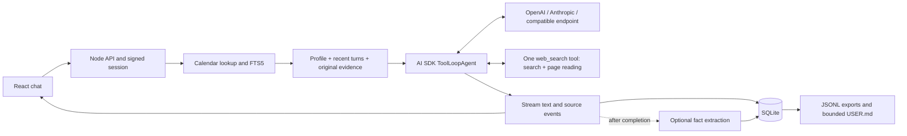

# Architecture and implementation notes

Research date: 15 November 2026. This document describes the implemented version and explicitly separates follow-up work.

## Shape

One process and one local database. No Redis, remote vector store, scheduling framework, or coding-agent subprocess. Express hosts the API and Vite middleware in development; production serves Vite’s built assets. AI SDK is used as a provider abstraction and tool-loop implementation, without a Vercel gateway or hosting dependency.

## The provider decision

| Candidate | Assessment for this task |
| --- | --- |
| AI SDK with direct adapters | Chosen: typed provider instances, streaming, validated tool schemas, bounded loop, test provider. |
| OpenAI Agents SDK | Viable; its documented AI SDK integration can provide other models. The extra orchestration layer buys little for one agent and one tool. |
| Claude Agent SDK | Embeds Claude Code's runtime and tools. This chat needs a model adapter and one narrow tool, so the native Anthropic API adapter is a closer fit. |
| Pi’s model library | Viable unified model layer. Borrow record simplicity; avoid coupling this web app to a coding harness or subscription/auth catalog. |
| LangChain/LangGraph | Viable provider ecosystem. Graph/checkpoint abstractions are unnecessary for this small request-response loop. |
| ACP | Useful between editors and coding agents. Model provider interoperability is a different layer. |

The model ID is configuration, not application logic. OpenAI defaults to `gpt-6-luna`; the Anthropic and compatible IDs are supplied by the operator. No silent fallback sends a user’s conversation to a different provider. Adding a native Google/Bedrock adapter later is localized to `server/models.ts`; it is not implemented now. “Compatible” means a working OpenAI-style streaming chat API with function calling, not every arbitrary model API.

## Request contract

1. Validate the signed browser session, conversation ownership, provider configuration, message size, and IANA timezone. Only one response per conversation may run at once; a small global concurrency cap bounds local load.
2. Commit the user’s exact message. Index its text synchronously. Date mentions are resolved against the message’s own timestamp/timezone, not the clock at later retrieval.
3. Compute current clock and candidate calendar windows. Fetch date matches or top lexical matches, then neighboring user/assistant turns. Rank only within the current user’s data. Pass provenance and coverage flags to the model.
4. Combine the small profile, bounded historical excerpts, and recent messages. The current user request is preserved in full. The instruction prefix is stable; changing clock/history follows it. Old tool bodies are not replayed wholesale.
5. Stream the SDK agent’s output. `web_search` is the sole callable tool. The final allowed step disables tool calls so it can synthesize the evidence already obtained.
6. Only a successful terminal `stop` with nonempty text is stored as a complete answer. Other terminal reasons, interrupted streams, and failures produce an incomplete record. The UI waits for a `done` event before treating completion as successful.
7. After the answer, queue optional profile extraction. It never gates the next turn’s ability to find the original message.

The browser receives newline-delimited JSON events: `memory`, `status`, `text`, `sources`, `done`, or `error`. `done` includes retrieval time, first-text time, total time, and available token counts. The custom wire format is intentionally small; it carries no model-specific tool protocol or reasoning text. Provider adapters and the SDK own the actual tool protocol.

## What memory lives where?

| Layer | Content | Growth and prompt policy |
| --- | --- | --- |
| Profile | Explicit durable preferences, role, timezone, named ongoing projects; source quote and message ID per fact | Rendered text capped at 1,600 characters. No transcript summaries or inferred thoughts. |
| Exact conversations | Original questions, answers, timestamps, status | Stored in SQLite and projected into per-chat JSONL. Retrieved when relevant. |
| Date mentions | Candidate date interval mentioned in a user message | Small SQL index; records a mention, not proof an event happened. |
| Research evidence | Search query, URL, title, returned excerpt, observation time, optional reported publication time, search/page kind | Stored with the answer; historical prompt includes source metadata rather than all page bodies. |

`USER.md` is generated from structured facts in SQLite. Editing that file does not edit the profile. It is not another authoritative store and does not grow after every chat. Facts are proposed only when useful beyond the turn: explicit preferences, corrections, durable context or remember requests. Ordinary questions, passing moods, guessed motives, and broad conversation summaries do not qualify.

The extractor returns at most three keyed proposals. Application code verifies that the supporting quote occurs in an actual user message owned by that user, checks field sizes, enforces the profile cap, and rejects older-source overwrites. Quote validation establishes provenance; it does not mathematically prove that a generated paraphrase follows from the quote. This remains an evaluation concern. Credential/sensitive-topic patterns skip extraction; the filter is conservative and not an exhaustive privacy classifier.

When a new key would exceed capacity, it is skipped; existing facts and original chats remain intact. Updating an existing key can still succeed if the resulting profile fits. We do not recursively summarize or discard transcripts to make a profile fit. Forgetting writes a tombstone so an outstanding extraction cannot restore the old fact. A newly stated fact can qualify again. Deleting a conversation cascades to its facts, mentioned dates and FTS entries. JSONL appends committed messages rather than rewriting full chats per turn; startup atomically rebuilds projections from SQLite to repair interrupted appends. JSONL is a readable projection, not a second transactional database.

## Retrieval and dates

FTS5 uses Unicode tokenization and BM25, with small explicit aliases such as Postgres/PostgreSQL and pricing/cost. Queries are generated from lexical terms and bound as SQL parameters. No shell or arbitrary `rg` command is available to the model. `rg` remains useful for manual debugging of exported JSONL, but FTS offers ranked results and scoped queries without launching a process per turn.

For date questions, SQL interval lookup works even when the user provides no topic: “what did I ask on 3 November?” Date windows are local calendar days converted to half-open UTC intervals. They can span 23/25 hours at DST transitions. “Last Tuesday” on Sunday, 15 November 2026 resolves to 10 November in the supplied timezone. A missing year checks the most recent past date plus two prior years; multiple matching years are flagged. This is a bounded policy, not unlimited historical year inference.

Conversation-time questions use message timestamps. Event-oriented questions can also match date mentions in later messages. A phrase such as “Monday, November 3, 2026” has an inconsistent weekday/date and is surfaced as such. The model must use matching evidence or clarify. Month/week ranges are supported with Monday-start calendar weeks. Locale conventions, multiple distinct dates in one query, arbitrary date arithmetic and very old unstated years are current limitations.

Candidate retrieval is intentionally simple: up to eight lexical hits or forty direct date hits per candidate window, expanded to neighboring turns. Historical message text has a 14,000-character total budget and 3,500-character per-message cap. Recent older turns have an 8,000-character budget; the current request is limited to 10,000 characters and is not silently cut. These are character budgets, not guaranteed token counts. Truncation is labeled; exhaustive day/month recall must not be claimed from incomplete coverage.

Failure mode: paraphrases without shared vocabulary may miss history, and a busy day can exceed the recall budget. Current behavior is honest uncertainty and a focused clarification. Next steps should be chosen from measured failures: constrained query rewriting, better term expansion, date pagination, then local embedding fallback. A separate model-facing `memory_search` would violate the challenge’s one-tool constraint and is deliberately absent.

## “What changed?” is an evidence comparison

For the CRM example, first recover the actual five names and 20-seat constraints. Search each named vendor’s official pricing or changelog, keeping user-specific constraints out of search queries when unnecessary. Compare equivalent plans, currencies, billing terms, seat requirements and usage allowances. A changed monthly/annual toggle is not a confirmed price change.

Historical answer + saved excerpts establish what was said/observed then. Fresh search and official page reads establish what is observed now. A dated announcement or historical evidence is needed to establish when something changed. Without that evidence, the answer should say the current page differs from the earlier answer, or that a change could not be verified. It must not claim a new effective date or that the old answer was correct. If the earlier answer was wrong, say so.

## Web search and latency

One tool accepts up to three independent queries and up to three reads of already-known source URLs. For Groq, function calls use a strict schema with all argument fields required (empty arrays are allowed). The model-facing URL fields use plain strings because Groq strict schemas reject the URI format; application URL validation and the returned-source allowlist still apply. Groq freshness requests force the named web_search tool on the first step so an earlier answer cannot replace revalidation. Groq GPT-OSS uses low reasoning effort, and model-facing search evidence is compacted with truncation markers while stored/UI evidence remains intact. Tavily Search uses `fast`, four results per query, no generated answer, and bounded excerpts. Tavily Extract reads pages through the same tool. The server does not fetch arbitrary model-provided URLs itself. URL reads are restricted to prior/current source URLs. All returned text is untrusted evidence.

Ordinary search has a bounded 100-query, five-minute in-memory cache. Freshness requests bypass it and request a short provider maximum age. This cannot guarantee a website’s origin changed recently or that its index is current. Reads, snippets, missing results and errors remain distinguishable. Observation timestamps are kept even for cache hits. Up to nine external operations, five model steps, eight-second external request deadlines, and a configurable 120-second response deadline (CHAT_TIMEOUT_MS, capped at 300 seconds) bound a turn. Independent operations use `Promise.allSettled`, so one failed vendor does not erase successful results. Retry behavior is bounded; rate limits are not hidden with repeated loops.

The common conversational path needs no routing model call and no web call. Extraction runs after completion and may still consume quota/compete for provider capacity; operators can disable it. The extraction queue is memory-only and bounded; a process crash can lose pending jobs, while transcripts remain indexed. Initial retrieval is synchronous local SQL. A large deployment would move expensive queries/exports off the event loop and use durable jobs; this version targets a small challenge workload.

Latency goals to validate, **not measured claims**: local retrieval p95 below 50 ms on 10k messages, first visible text below 2 s for ordinary chat, and typical researched answers below 10 s. Multi-vendor verification can take longer. Measure p50/p95 by request type, useful first text, total completion, search time, failures, token usage, and memory recall separately. Do not count a spinner as first answer text.

Local measurement on 15 November 2026 (`npm run bench`, Node 25.9.0 on the development machine): 10,000 synthetic messages across 500 conversations, five warmups and fifty measured queries. Keyword recall measured p50 9.47 ms / p95 10.20 ms; bounded date-only recall measured p50 1.95 ms / p95 2.19 ms. These results validate the small local retrieval path on that fixture only. They exclude model/network latency, source-heavy histories, cold starts and production contention, and do not measure answer accuracy.

## Deployment boundary and remaining work

The app is runnable with `npm install` and `npm run dev`. Use a persistent volume and one Node process. Signed random browser IDs scope records and endpoint access; they are not identity accounts. Cookies should be HTTPS-protected at deployment. The shared access gate and concurrency limits are demo controls, not rate limiting, per-user billing, recovery, or a complete production security layer. Multiple app instances, public self-service registration, user-supplied provider keys, durable queues, and encrypted secret storage are not implemented.

No API keys were available during implementation. Mocked tests validate control flow, persistence and provider-independent contracts; they do not establish Luna/Claude tool quality, production API compatibility, search quality, or real latency. Before submission, run live tests on the selected provider and Tavily, including the three challenge questions, unavailable sources, deliberate old-answer errors and ambiguity. Do not submit mock output as live evidence.
